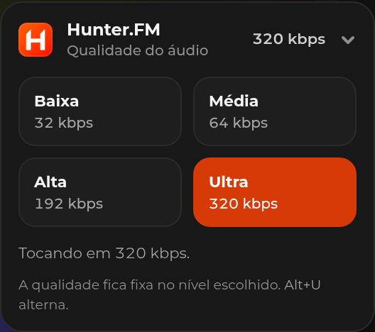
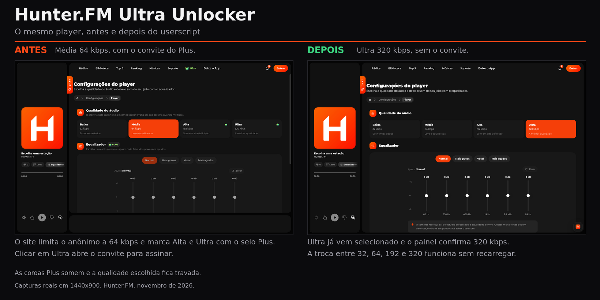
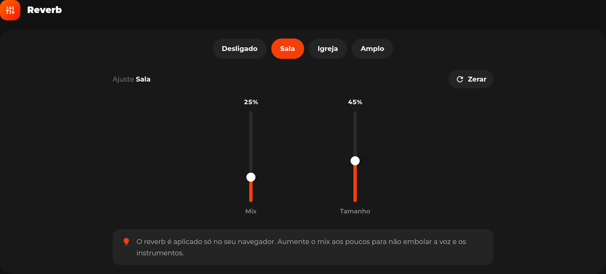
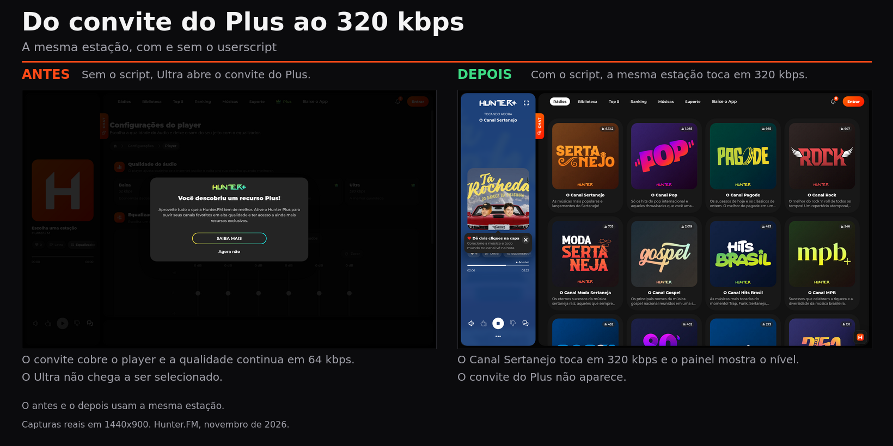

  

<h1 align="center">Hunter.FM Ultra Unlocker</h1>

  Um userscript para o player web da Hunter.FM. Ele deixa as quatro qualidades de áudio disponíveis, começa em 320 kbps e mantém a qualidade escolhida. Também adiciona uma seção de reverb na página de configurações.

  
  
  

  <a href="#o-que-muda">O que muda</a> •
  <a href="#reverb">Reverb</a> •
  <a href="#apoie-a-hunterfm">Apoie</a> •
  <a href="#instalar">Instalar</a> •
  <a href="#usar">Usar</a> •
  <a href="#testado">Testado</a> •
  <a href="#limites">Limites</a> •
  <a href="docs/how-it-works.md">Como funciona</a>

---

## O que muda

O player da Hunter.FM oferece 32, 64, 192 e 320 kbps. As opções Alta e Ultra aparecem com uma coroa Plus e, sem uma conta Plus, escolher Ultra abre um convite para assinar.

O userscript deixa as quatro opções disponíveis. A estação começa em 320 kbps e o convite não aparece. O painel permite trocar de nível durante a reprodução. As coroas em Alta e Ultra somem.

A qualidade fica travada no nível escolhido. Se a conexão oscilar, o player não troca sozinho para um nível menor; o script reaplica a sua escolha. O aviso de ajuste automático da página de qualidade também some.

## Reverb

Na página [Configurações do player](https://hunter.fm/configuracoes/player/), abaixo do equalizador, o script adiciona uma seção **Reverb**:

| Controle | O que faz |
| --- | --- |
| Desligado, Sala, Igreja, Amplo | Presets prontos de ambiência |
| Mix | Quantidade de reverb no som, de 0% a 100% |
| Tamanho | Duração da cauda, de curta a longa |
| Zerar | Volta ao estado inicial |

O efeito roda no seu navegador e não altera o áudio enviado pela rádio. Ele usa a Web Audio API; no iOS o controle fica indisponível.

## Apoie a Hunter.FM

Este script existe para quem não pode pagar agora, quer testar o player ou precisa de uma qualidade que a conta gratuita não libera. A Hunter.FM é uma rádio independente e o Plus é o que mantém a estrutura de pé: estúdios, programação, equipe e a parte que chega aos artistas.

Se você ouve a Hunter todo dia e tem condição, assine o [Hunter Plus](https://hunter.fm/plus/). Além de liberar Alta, Ultra e o equalizador, você tira os anúncios e ajuda a rádio a continuar no ar.

Usar o script sem nunca retribuir é confortável para quem ouve e caro para quem produz. Se ele te economiza uma assinatura, considere pagar pelo menos um mês do Ultra. A Hunter faz por merecer.

## Instalar

1. Instale o [Tampermonkey](https://www.tampermonkey.net/) ou o [Violentmonkey](https://violentmonkey.github.io/).
2. Abra [`hunterfm-ultra-unlocker.user.js`](hunterfm-ultra-unlocker.user.js) e confirme a instalação. Se o gerenciador não abrir sozinho, use o botão **Raw**.
3. Entre em https://hunter.fm/ e dê play em uma estação.

## Usar

Fora de uso, o painel fica reduzido a um quadrado com o logo no canto inferior direito. Toque nele para abrir; ele se recolhe sozinho alguns segundos depois.

| Ação | O que acontece |
| --- | --- |
| Clique no quadrado do logo | Abre o painel |
| Clique em Baixa, Média, Alta ou Ultra | Troca a qualidade na hora |
| `Alt+U` | Passa por 320, 192, 64 e 32 |
| Clique no título do painel | Recolhe para o quadrado |
| Abra Configurações do player | Mostra a seção de Reverb |

A escolha de qualidade e o reverb ficam salvos no navegador e voltam na próxima visita.

## Testado

Os testes usaram uma sessão limpa do player web. As capturas e o log completo estão em [Como funciona](docs/how-it-works.md).

| Item | Resultado |
| --- | --- |
| Estações | 15 de 15 com a opção de 320 kbps disponível |
| Player | O Canal Sertanejo em 320 kbps |
| Troca de qualidade | 32, 64, 192 e 320 sem recarregar |
| Qualidade automática | o player não troca sozinho para um nível menor |
| Coroas Plus | escondidas em Alta e Ultra |
| Reverb | presets, mix e tamanho aplicados no áudio do navegador |
| Convite do Plus | não aparece ao escolher Ultra |
| Persistência | qualidade e reverb voltam depois de recarregar |
| Ambiente | Chrome 155, 1440×900, sessão limpa |

## Limites

> [!IMPORTANT]
> Este projeto não é afiliado à Hunter.FM. Ele muda apenas o player no seu navegador e não altera sua conta.

- O projeto está em desenvolvimento. Se a Hunter.FM mudar o player, o script pode parar de funcionar.
- A qualidade fica travada no nível escolhido. Se a conexão não acompanhar, o áudio pode bufferizar. O script não reduz sozinho para evitar isso.
- O reverb depende da Web Audio API. Só quem está ouvindo no seu navegador escuta o efeito; ele não é enviado para a rádio.
- Anúncios em banner continuam. No caminho usado pelo script, o anúncio de áudio do play não é injetado.
- Use por sua conta e risco e respeite os termos da Hunter.FM.

## Documentação

Os detalhes técnicos, a tabela de estados, o log de rede e as capturas originais estão em [docs/how-it-works.md](docs/how-it-works.md).
