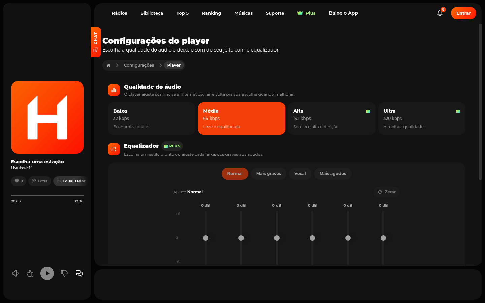
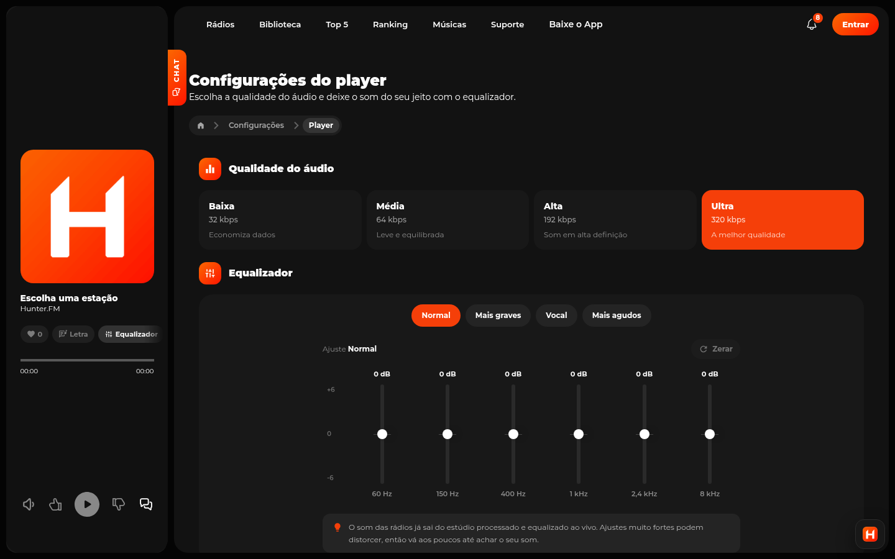
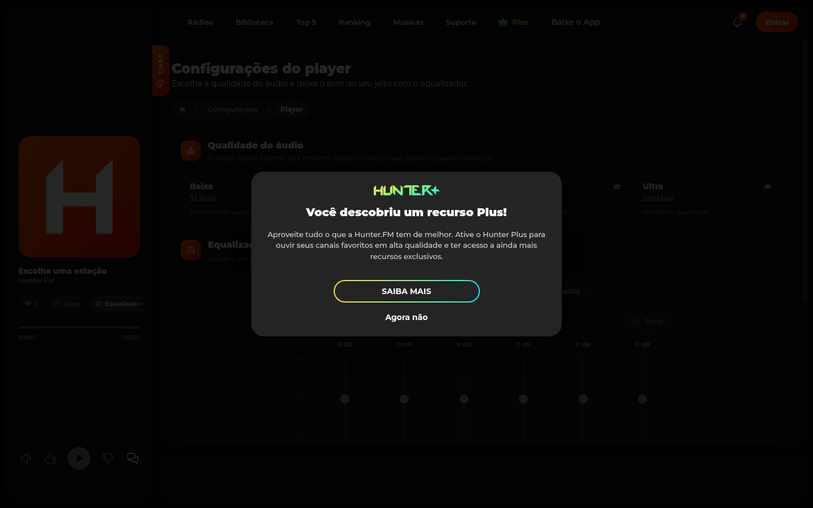
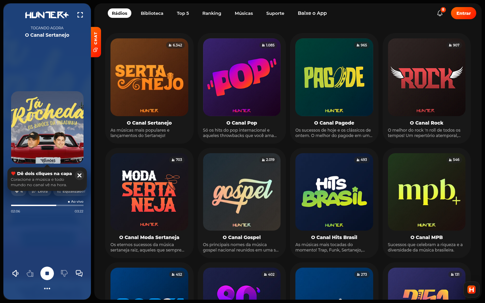
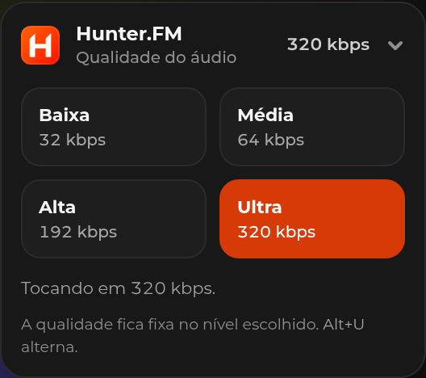
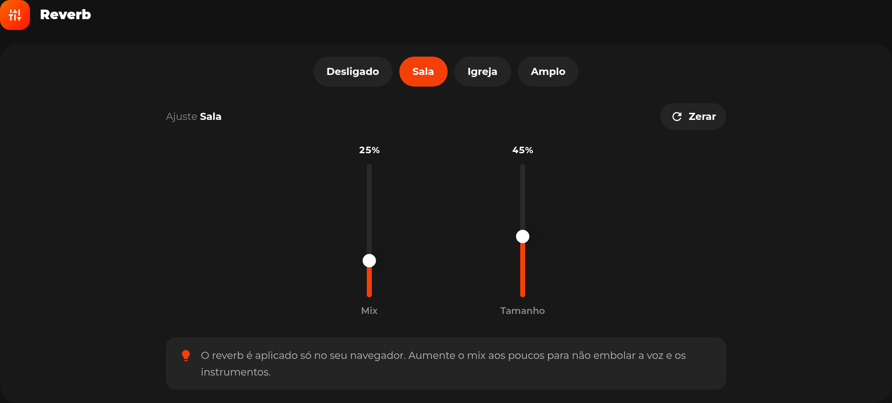

# Como funciona

Este documento registra o que o userscript altera no player da Hunter.FM, como o player decide a qualidade, como o reverb é aplicado e quais evidências sustentam o resultado. As capturas e os testes são de novembro de 2026, no player web.

[Voltar ao README](../README.md)

## Resumo

O player da Hunter.FM oferece quatro níveis de áudio: 32, 64, 192 e 320 kbps. A escolha fica no estado do player e o site usa um sentinela de conta premium para liberar os dois níveis maiores. O userscript coloca esse sentinela antes do site carregar, escolhe o nível 3 e mantém o estado enquanto a página está aberta.

O gate inteiro roda no navegador. A variante de 320 kbps do stream é pública; o script não quebra autenticação nem altera o servidor.

O script também adiciona uma seção de reverb na página de configurações. O efeito é aplicado no navegador, via Web Audio API, e não muda o que a rádio envia.

## O que o script altera

| Sinal | Antes | Depois |
| --- | --- | --- |
| `userStore.uwu` | `""` | `"tUdpciY6"` |
| `playerStore.quality` | `1` (Média 64) | `3` (Ultra 320) |
| `playerStore.playingQuality` | `null` (sem play) | `3` (tocando) |
| `siteManager.showPlusModal` | `true` ao clicar em Ultra | `false` |

O antes foi capturado na página de qualidade, sem reprodução. O depois combina a página de qualidade e o player com O Canal Sertanejo tocando; os valores de `playingQuality` e `showPlusModal` vêm do player.

Além desses valores, o script:

- grava `hunter:plus-quality = "3"`, `hf-ultra:pref` e `hf-ultra:reverb` no `localStorage`;
- chama `$hlsPlayer.setQuality(station, 3)` antes do primeiro `playChannel`, para o primeiro manifesto já começar em 320;
- observa o store e reaplica o sentinela se o site tentar limpá-lo;
- reaplica o nível escolhido quando o HLS tenta reduzir a qualidade sozinho;
- esconde as coroas Plus dos cartões Alta e Ultra e o aviso de ajuste automático da página de qualidade;
- monta o painel em shadow DOM, com os botões Baixa/Média/Alta/Ultra e o atalho `Alt+U`. Fora de uso, o painel fica reduzido a um quadrado com o logo, no canto inferior direito, e se recolhe sozinho depois de alguns segundos;
- injeta a seção **Reverb** ao lado do equalizador, com presets, mix e tamanho;
- define o cookie `noLoggedClosed=yes` para o popup de login anônimo não abrir. O botão "Entrar" do cabeçalho continua funcionando.

## Qualidade travada

O site descreve o ajuste automático como "O player ajusta sozinho se a internet oscilar e volta pra sua escolha quando melhorar." Esse texto é escondido pelo script e o comportamento é desativado.

O HLS.js do player tenta reduzir o nível quando a banda cai. O usuário pediu para desativar essa redução automática. O script escuta `playerStore/setPlayingQuality` e, quando o nível real fica abaixo do escolhido, chama `setQuality` de novo com o nível preferido. O `setQuality` do site define `R.autoLevelCapping` e `R.nextAutoLevel`, o que força o HLS a voltar para o nível pedido. Há um intervalo de 2 segundos entre reaplicações para não martelar o player.

O resultado é uma escolha fixa: se a conexão não acompanhar 320 kbps, o áudio pode bufferizar, mas o player não troca sozinho para 64 ou 32.

## Reverb

A seção **Reverb** é clonada da seção do equalizador e mantém as mesmas classes, fontes, cores e controles. Ela aparece abaixo do equalizador em `/configuracoes/player/` e usa:

- **Desligado, Sala, Igreja e Amplo** como presets;
- **Mix** (0% a 100%) para a quantidade de efeito;
- **Tamanho** (0% a 100%) para a duração da cauda;
- **Zerar** para cortar o efeito e deixar mix e tamanho em 0%.

O áudio do elemento `<audio>` do player passa por um grafo Web Audio próprio:

```text
<audio> -> MediaElementSource -> [dry + convolver] -> destino
```

O sinal seco e o sinal com convolução são somados conforme o mix. O impulso do convolver é gerado no navegador: duração e decaimento mudam com o controle de tamanho.

O script compartilha o mesmo `AudioContext` com o equalizador do site. Quando o equalizador é ativado, a conexão final dele para o destino é redirecionada para a entrada do reverb, então os dois efeitos funcionam juntos, sem duplicar o áudio.

O reverb depende de `AudioContext` e `MediaElementSource`. No iOS, onde o player do site também evita esse caminho, a seção aparece desativada com o aviso "Indisponível neste navegador".

## Achados

### O gate é client-side

O bundle do player checa o sentinela `userStore.uwu` para decidir se a conta é premium. A checagem encontrada no bundle atual é:

```js
isOwo() {
  return "tUdpciY6" === this.$store.state.userStore.uwu;
}
```

O valor `tUdpciY6` funciona como um sentinela que o próprio cliente usa para marcar a sessão como premium. O script o define antes do Nuxt iniciar e mantém o valor se o site tentar limpar.

### A qualidade é um índice de 0 a 3

| Valor | Nível | Bitrate |
| --- | --- | --- |
| `0` | Baixa | 32 kbps |
| `1` | Média | 64 kbps |
| `2` | Alta | 192 kbps |
| `3` | Ultra | 320 kbps |

O `playerStore.quality` guarda a escolha; `playerStore.playingQuality` mostra o nível que o HLS está usando.

### O stream de 320 kbps é público

O master `https://stream.hunter.fm/<estacao>.m3u8` redireciona para `https://hls.hunter.fm/<estacao>.m3u8`, que lista as variantes 320, 192, 64 e 32. O teste abriu os 15 masters da grade e todos ofereceram a variante de 320 kbps. Os segmentos de áudio também carregaram sem autenticação.

As estações verificadas foram: O Canal Sertanejo, O Canal Pop, O Canal Pagode, O Canal Rock, O Canal Moda Sertaneja, O Canal Gospel, O Canal Hits Brasil, O Canal MPB, O Canal Pop2K, O Canal 80, O Canal Master, O Canal Pisadinha, O Canal Tropical, O Canal Lo-Fi e O Canal K-pop.

Exemplo do teste:

```text
GET https://stream.hunter.fm/sertanejo.m3u8
GET https://hls.hunter.fm/sertanejo/320.m3u8
GET https://hls.hunter.fm/sertanejo/320/358896697-0.aac
```

### O primeiro play precisa de setQuality

O player interno só troca a variante quando `$hlsPlayer.setQuality(station, level)` é chamado. Se o script apenas mudasse o store, o primeiro manifesto poderia começar no nível anterior. Por isso o script chama `setQuality` antes de `playChannel`.

### O modal Plus é separado do áudio

As opções Alta e Ultra têm uma coroa Plus no layout. Sem o sentinela, clicar em uma delas abre o modal e não troca a qualidade. Com o sentinela presente, a opção troca normalmente e o modal não aparece. O script esconde a coroa, mas mantém o clique funcionando.

### Outros efeitos do estado premium

No teste, o caminho premium também evitou o anúncio de áudio injetado no play e liberou o equalizador e o controle de skip. Anúncios em banner continuam. O script não remove esses banners.

## Evidências

As capturas foram feitas em 1440×900, com Chrome 155 headless via Playwright. O antes e o depois usaram contextos limpos, sem cookies ou `localStorage` antigos. O script foi injetado em `document-start` no depois.

| Antes | Depois |
| --- | --- |
|  |  |
|  |  |





O log de rede do teste está em [`after-network.json`](../assets/after-network.json). Os pedidos de variante e de segmentos foram todos para `/320/`:

```text
GET https://stream.hunter.fm/sertanejo.m3u8
GET https://hls.hunter.fm/sertanejo/320.m3u8
GET https://hls.hunter.fm/sertanejo/320/358896697-0.aac
GET https://hls.hunter.fm/sertanejo/320/358896698-0.aac
```

Nenhum pedido para `/32/`, `/64/` ou `/192/` apareceu durante a reprodução.

### Página nativa

Em `/configuracoes/player/`, o Ultra fica selecionado, a troca entre 32/64/192/320 funciona, o modal Plus não aparece, as coroas somem e a seção de reverb fica disponível.

### Persistência

Depois de recarregar, a escolha de qualidade e os controles de reverb voltam. O script também reaplica o sentinela se o site tentar limpar o estado.

## Como reproduzir

1. Instale o userscript e abra https://hunter.fm/.
2. Dê play em uma estação.
3. Abra o DevTools e rode no console:

```js
const store = window.$nuxt.$store;
console.table({
  uwu: store.state.userStore.uwu,
  quality: store.state.playerStore.quality,
  playingQuality: store.state.playerStore.playingQuality,
  plusModal: store.state.siteManager.showPlusModal,
});
```

4. Na aba Network, filtre por `hls.hunter.fm`. Os pedidos de áudio devem conter `/320/`.
5. Abra `/configuracoes/player/` e escolha Ultra. O modal Plus não deve aparecer, as coroas não devem aparecer e a seção Reverb deve estar logo abaixo do equalizador.
6. Ative o preset **Sala** e mova o mix. O som deve ganhar ambiência sem sair do navegador.

## Limites

- O script depende do bundle atual do player. Se a Hunter.FM mudar os nomes ou o fluxo de qualidade, ele pode parar.
- O HLS ainda pode tentar reduzir a qualidade; o script reaplica o nível escolhido. Se a rede não acompanhar, o áudio pode bufferizar.
- O reverb depende da Web Audio API e fica indisponível no iOS.
- O script não altera a conta nem o servidor. Ele também não faz login.
- Anúncios em banner continuam.
- Use por sua conta e risco. O projeto não é afiliado à Hunter.FM.
